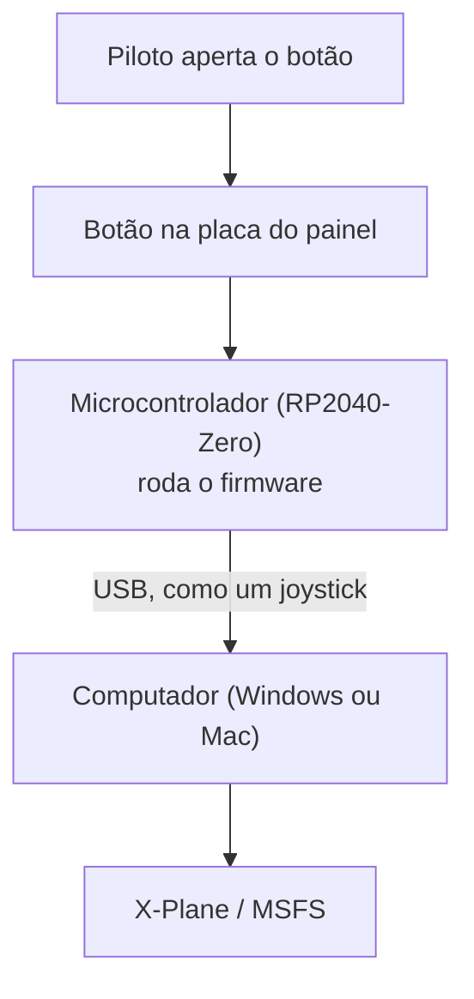

# Comando Cockpit Hardware

A **Comando** faz **painéis físicos** para simuladores de voo: caixas com
botões e botões giratórios de verdade, iguais aos de um avião. Você liga o
painel no computador por USB e usa no X-Plane ou Microsoft
Flight Simulator.

Não é um painel só. É uma **plataforma**: uma base comum de eletrônica,
programa e processos, em cima da qual vários painéis diferentes são
construídos.

  
  

> **Plugou, funcionou.** O computador reconhece o painel sozinho, como
> reconhece um mouse ou um controle de videogame. Um instalador simples liga
> cada botão ao comando certo do simulador, sem programa extra aberto e sem
> driver.

## Como funciona

- **Firmware**: o programa gravado no microcontrolador do painel. Ele se
  apresenta ao computador como um joystick USB padrão.
- **Placa**: desenhada como código, a partir de um arquivo de configuração
  de cada painel. Os controles são posicionados à mão e o resto é gerado.
- **Instalador**: app para Windows e Mac que configura os botões no
  simulador e baixa atualizações assinadas, sem exigir instalador novo.
- **Plugin**: no X-Plane, acelera os botões giratórios quando giram rápido.

## Painéis

| Painel | O que é | Estado |
|---|---|---|
| **g1000-autopilot** | Piloto automático no estilo do Garmin G1000 (layout GFC700): 12 botões e 2 botões giratórios (rumo e altitude) | Firmware testado na bancada; placa verificada, ainda não fabricada; instalador e plugin funcionando no X-Plane 11 (Windows) e 12 (macOS) |
| **c172-switch-panel** | Painel de chaves de um Cessna 172: magnetos, bateria, alternador, luzes, bomba de combustível | Só planejado |

## Atualizações

Firmware, plugin e perfis de botões ficam publicados no repositório público
[comando-releases](https://github.com/Comando-Cockpit-Hardware/comando-releases).
Cada publicação traz os arquivos novos e uma lista assinada digitalmente. O
instalador confere a assinatura antes de baixar qualquer coisa, para que só
arquivos publicados pela Comando cheguem ao painel.

## Documentação

A documentação para quem não é da área (sem precisar saber de placas,
firmware ou USB) está em
[docs.comandoch.com.br](https://docs.comandoch.com.br). Ela explica o que é
cada parte, como o projeto se organiza e as decisões tomadas.

## Contato

Dúvidas e contato: comandocockpit@gmail.com
