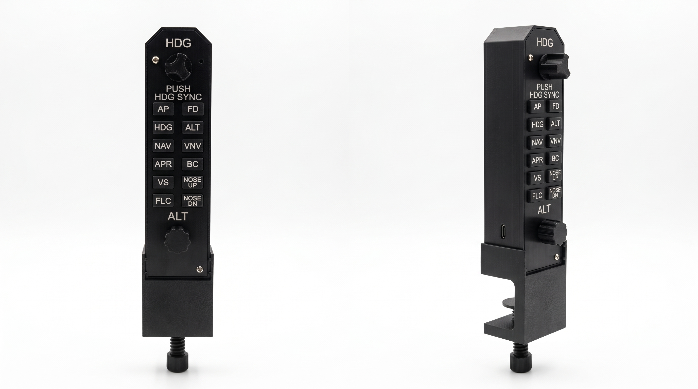
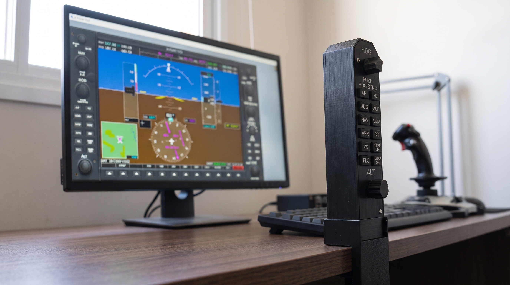

  

A **Comando** faz **painéis físicos** para simuladores de voo: caixas com
botões e botões giratórios de verdade, iguais aos de um avião. Você liga o
painel no computador por USB e usa no X-Plane ou Microsoft Flight Simulator.

> **Plugou, funcionou.** O computador reconhece o painel sozinho, como
> reconhece um mouse ou um controle de videogame. Um instalador simples liga
> cada botão ao comando certo do simulador, sem programa extra aberto.

  

## Nossos produtos

> 

> 
<strong>Comando AP1</strong>: Controlador de piloto automático

>
> Painel de piloto automático no estilo do Garmin G1000. Ele reúne, num só
> lugar, os controles que o piloto usa para dirigir o avião com o piloto
> automático, em vez de clicar na tela do simulador.
>
> > 

>   
>   
> 

> 
> **Botões**
>
> - **AP**: liga e desliga o piloto automático.
> - **FD**: liga e desliga o diretor de voo (as barras de guia do painel).
> - **HDG**: segura o avião no rumo escolhido.
> - **NAV**: segue a rota de navegação selecionada.
> - **APR**: faz a aproximação para o pouso.
> - **VS**: segura a razão de subida ou descida escolhida.
> - **ALT**: segura a altitude atual.
> - **FLC**: sobe ou desce mantendo a velocidade escolhida.
> - **VNV**: segue o perfil vertical da navegação (VNAV).
> - **BC**: modo de retorno (back course) para aproximações por localizador.
> - **NOSE UP** e **NOSE DN**: levantam ou abaixam o nariz do avião.
>
> **Botões giratórios**
>
> - **Rumo (HDG)**: gire para mudar o rumo. Girar rápido muda o rumo mais depressa.
>   Pressione o botão para sincronizar o rumo com o do avião (HDG SYNC).
> - **Altitude (ALT)**: gire para mudar a altitude selecionada. Girar rápido muda a
>   altitude mais depressa. Pressione o botão para sincronizar a altitude com a do
>   avião.
>
> **Compatibilidade**
>
> | Simulador | Windows | macOS |
> |---|---|---|
> | X-Plane 11 | ✅ Funciona | ✅ Funciona |
> | X-Plane 12 | ✅ Funciona | ✅ Funciona |
> | MSFS 2020 | ✅ Funciona | ❌ Não disponível |
> | MSFS 2024 | ✅ Funciona | ❌ Não disponível |
>
> Conecta por USB. O instalador da Comando configura os
> botões e os plugins no simulador automaticamente.
>
>
> 

## Contato

Dúvidas e contato: comandocockpit@gmail.com
